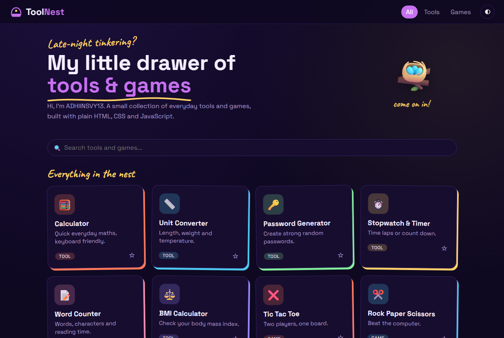

# ToolNest

A small collection of everyday tools and games, built with plain HTML, CSS and JavaScript.

**Live:** https://adhiinsvy13.github.io/ToolNest/



## Includes

- **Tools:** Calculator, Unit Converter, Password Generator, Stopwatch & Timer, Word Counter, QR Code Generator, BMI Calculator
- **Games:** Tic Tac Toe, Rock Paper Scissors, Number Guess, Memory Match

Also has search, pinned favourites, a light/dark theme and saved scores.

## Run locally

```bash
git clone https://github.com/ADHIINSVY13/ToolNest.git
```

Open `index.html` in your browser. No install or build needed.

## Author

[ADHIINSVY13](https://github.com/ADHIINSVY13)
